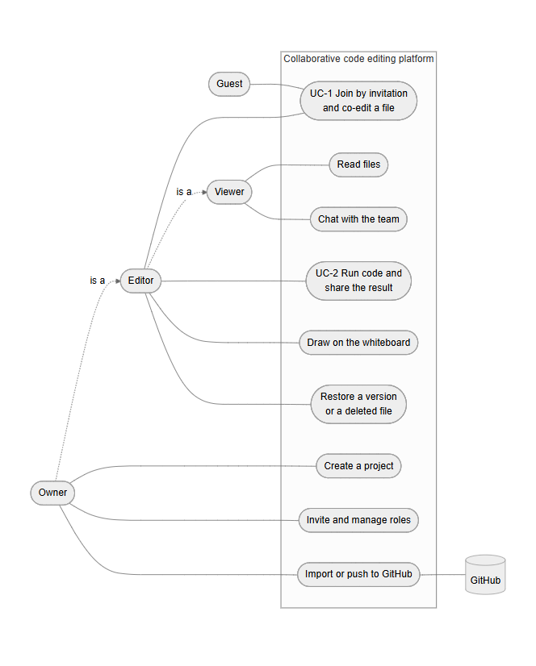
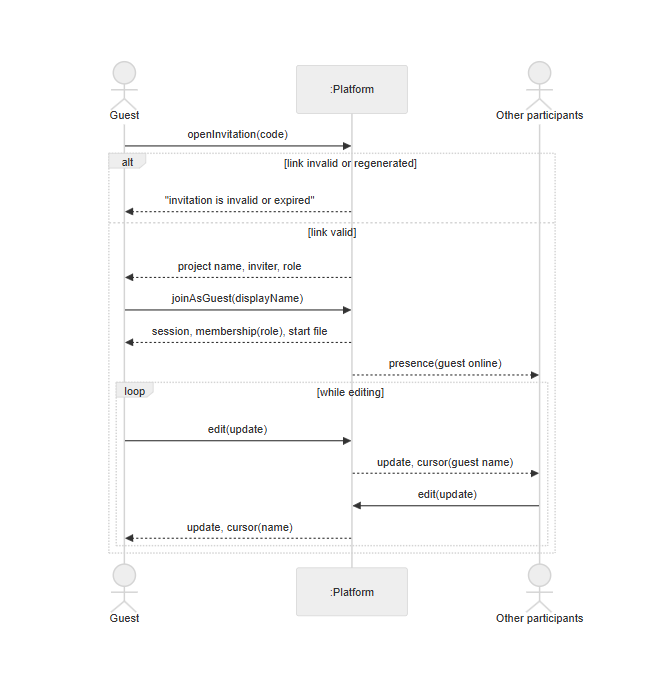
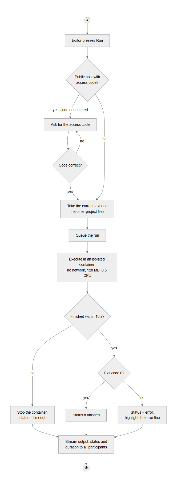

# References

1. Stack Overflow, "2024 Developer Survey: Work," 2024. [Online]. Available: https://survey.stackoverflow.co/2024/work (accessed Oct. 23, 2026).
2. C. A. Ellis and S. J. Gibbs, "Concurrency control in groupware systems," in *Proc. 1989 ACM SIGMOD Int. Conf. Management of Data*, Portland, OR, USA, 1989, pp. 399–407, doi: 10.1145/67544.66963.
3. C. Sun and C. Ellis, "Operational transformation in real-time group editors: Issues, algorithms, and achievements," in *Proc. 1998 ACM Conf. Computer Supported Cooperative Work (CSCW '98)*, Seattle, WA, USA, 1998, pp. 59–68, doi: 10.1145/289444.289469.
4. M. Shapiro, N. Preguiça, C. Baquero, and M. Zawirski, "Conflict-free replicated data types," in *Stabilization, Safety, and Security of Distributed Systems (SSS 2011)*, Lecture Notes in Computer Science, vol. 6976. Berlin, Germany: Springer, 2011, pp. 386–400, doi: 10.1007/978-3-642-24550-3_29.
5. P. Nicolaescu, K. Jahns, M. Derntl, and R. Klamma, "Near real-time peer-to-peer shared editing on extensible data types," in *Proc. 2016 ACM Int. Conf. Supporting Group Work (GROUP '16)*, Sanibel Island, FL, USA, 2016, pp. 39–49, doi: 10.1145/2957276.2957310.
6. M. Kleppmann and A. R. Beresford, "A conflict-free replicated JSON datatype," *IEEE Trans. Parallel Distrib. Syst.*, vol. 28, no. 10, pp. 2733–2746, 2017, doi: 10.1109/TPDS.2017.2697382.
7. M. Kleppmann, A. Wiggins, P. van Hardenberg, and M. McGranaghan, "Local-first software: You own your data, in spite of the cloud," in *Proc. 2019 ACM SIGPLAN Int. Symp. New Ideas, New Paradigms, and Reflections on Programming and Software (Onward! 2019)*, Athens, Greece, 2019, pp. 154–178, doi: 10.1145/3359591.3359737.
8. J. Gentle and M. Kleppmann, "Collaborative text editing with Eg-walker: Better, faster, smaller," in *Proc. 20th European Conf. Computer Systems (EuroSys '25)*, Rotterdam, The Netherlands, 2025, doi: 10.1145/3689031.3696076.
9. Yjs, "Yjs Docs." [Online]. Available: https://docs.yjs.dev/ (accessed Oct. 23, 2026).
10. J. Nielsen, *Usability Engineering*. Boston, MA, USA: Academic Press, 1993.
11. *Systems and Software Engineering — Systems and Software Quality Requirements and Evaluation (SQuaRE) — Product Quality Model*, ISO/IEC 25010:2023, 2023.
12. European Parliament and Council of the European Union, "Regulation (EU) 2016/679 (General Data Protection Regulation)," *Official Journal of the European Union*, L 119, pp. 1–88, May 4, 2016.
13. W3C, "Web Content Accessibility Guidelines (WCAG) 2.1," W3C Recommendation, 2018. [Online]. Available: https://www.w3.org/TR/WCAG21/ (accessed Oct. 23, 2026).
14. OWASP Foundation, "OWASP Top 10:2021," 2021. [Online]. Available: https://owasp.org/Top10/ (accessed Oct. 23, 2026).
15. Microsoft, "Security — Live Share," Microsoft Learn. [Online]. Available: https://learn.microsoft.com/en-us/visualstudio/liveshare/reference/security (accessed Oct. 23, 2026).
16. Replit, "Invite teammates," Replit Docs. [Online]. Available: https://docs.replit.com/build/invite-teammates (accessed Oct. 23, 2026).
17. Codeshare, "Share code in real-time with developers in your browser." [Online]. Available: https://codeshare.io (accessed Oct. 23, 2026).
18. Excalidraw, "Excalidraw — virtual whiteboard for sketching hand-drawn like diagrams," GitHub repository. [Online]. Available: https://github.com/excalidraw/excalidraw (accessed Oct. 23, 2026).

# Appendix A. Backlog

Table A.1 — Epics and user stories (MoSCoW: M — Must, S — Should, C — Could, W — Won't)

| ID | Epic | User story | Acceptance criteria | MoSCoW |
|---|---|---|---|---|
| US-01 | E1 | As a student, I want to create a project, so that my team has a permanent shared space. | Given a signed-in user, when the user creates a project with a name, then the project appears in the user's list with the user as owner and opens empty. | M |
| US-02 | E1 | As a project owner, I want to invite people with a link, so that they can join without manual setup. | Given a project, when the owner opens "Invite", then a link with a selectable role (editor or viewer) is shown and can be copied; when the owner regenerates it, then the old link stops working. | M |
| US-03 | E1 | As a guest, I want to join a project by a link entering only my name, so that I can start without registering. | Given a valid editor link and a visitor who is not signed in, when the visitor enters a name and confirms, then the visitor becomes an editor and the project opens within 5 s; given an invalid link, then an explanation is shown and no membership is created. | M |
| US-04 | E1 | As an owner, I want to change roles and remove members, so that I control who can change files. | Given a member with open files, when the owner changes the role to viewer, then the member's editor becomes read-only without reload; when the owner removes the member, then the member's tabs leave the project with a notice. | M |
| US-05 | E1 | As a user, I want to register and sign in with e-mail and password, so that my projects are kept between sessions. | Given a new e-mail and a password of at least 8 characters, when the user registers, then the user is signed in; given a wrong password, when the user signs in, then "Invalid e-mail or password" is shown without revealing which is wrong. | M |
| US-06 | E1 | As a member, I want to leave a project, and as an owner to delete it, so that my list stays relevant. | Given a member, when the member leaves, then the project disappears from the member's list; given the owner, when the owner confirms deletion, then the project is deleted for all members. | S |
| US-27 | E1 | As a user, I want to delete my account and my personal data, so that I can exercise my right to erasure. | Given a signed-in user, when the user confirms account deletion, then the account, its memberships and owned projects are deleted. | S |
| US-07 | E2 | As an editor, I want to edit the same file at the same time as others and see their changes instantly, so that we work as at one screen. | Given two editors in one file, when one types, then the text appears at the other within 100 ms (p95) and both replicas are identical after the edits stop. | M |
| US-08 | E2 | As a participant, I want to see the cursors and names of others and who is online, so that we do not edit the same place blindly. | Given two participants, when one moves the cursor, then the other sees a cursor labelled with the name, and both appear in the online list. | M |
| US-09 | E2 | As a participant with an unstable connection, I want to keep editing offline and have my edits merged automatically, so that no work is lost. | Given an editor who loses the connection, when the editor keeps typing and reconnects, then all offline and concurrent edits are merged without a conflict dialog and without lost characters. | M |
| US-10 | E2 | As a user, I want syntax highlighting for common languages, so that code is readable. | Given a file with a known extension (.js, .ts, .py, …), when it is opened, then the matching highlighting is applied. | S |
| US-11 | E3 | As a student, I want Markdown documents with live preview, so that task descriptions live next to the code. | Given a Markdown file, when a participant types, then the rendered preview updates for all participants. | S |
| US-12 | E3 | As a team member, I want a shared whiteboard with shapes, text and arrows, so that we can sketch the design next to the code. | Given a whiteboard, when a participant draws a shape or places a text label, then it appears for all participants and can be undone and exported to PNG or SVG. | S |
| US-13 | E4 | As a member, I want a project chat, so that the discussion stays with the code. | Given two members, when one sends a message, then the other receives it in real time and it remains in the history. | S |
| US-14 | E5 | As an editor, I want to run a JavaScript or Python file in a sandbox and see the output together with others, so that we check the same result. | Given a runnable file, when an editor presses Run, then all participants see the output, status and duration; on an error the line is highlighted; a run is stopped after 10 s. | S |
| US-15 | E5 | As an editor, I want an interactive terminal in a sandbox with the project files, so that I can run commands as in Git Bash. | Given an editor, when the terminal is opened, then a shell with the project files is available, has no network and closes after 30 min or when the panel is closed. | C |
| US-16 | E5 | As the operator of a public instance, I want code execution to require an access code, so that strangers cannot use my server. | Given a public instance with an access code, when a user without the code presses Run, then the code is requested and the run starts only after a correct code. | C |
| US-17 | E6 | As a student, I want to import a public GitHub repository by its URL, so that I can start from existing code. | Given a public repository URL, when the user creates a project from it, then the text files appear in the project with their folder structure. | S |
| US-18 | E6 | As a student, I want to push my changes back to GitHub as a commit, so that the work is saved in the repository. | Given a project linked to a repository and a valid token, when the user pushes, then changed files are committed and a conflict with newer remote changes is reported instead of being overwritten. | C |
| US-19 | E6 | As a student, I want to switch between repository branches, so that I can work on the branch I need. | Given an imported repository, when an editor selects another branch, then the files of that branch are shown to all participants. | C |
| US-20 | E7 | As an editor, I want a folder tree in which I can create, rename and delete files, so that the project is organised. | Given an editor, when the editor creates "src/app.js", then the folder "src" appears in the tree for all participants; renaming and deleting are reflected for everyone. | M |
| US-21 | E7 | As an editor, I want deleted files to stay in a trash for 30 days, so that mistakes can be undone. | Given a deleted file, when an editor opens the trash, then the file is listed with the remaining days and can be restored; after 30 days it is purged. | S |
| US-22 | E7 | As an editor, I want to see the version history of a file and restore a version, so that I can undo a bad change. | Given a file with saved versions, when an editor restores one, then all participants see the restored text and the replaced text is saved as a new version. | S |
| US-23 | E7 | As a user, I want to search by file name and by file contents, so that I can navigate a large project. | Given a project, when the user searches for a text, then matching files and lines are listed and a click opens the file at the line. | S |
| US-24 | — | As a team, we want voice and video calls in the project. | Out of scope (section 2.3). | W |
| US-25 | — | As a developer, I want a step-by-step debugger. | Out of scope (section 2.3). | W |
| US-26 | — | As a student, I want to import a private GitHub repository. | Out of scope for this release (section 2.3). | W |

# Appendix B. Diagrams

# Appendix C. Survey questionnaire

The questionnaire was distributed online in Russian; the English translation is given below. Questions 4–6 provide the KPI baselines.

0. Consent: "I agree that my anonymous answers are used in aggregated form in the diploma thesis." (required)
1. Who are you? (IT student / student of another field / working developer / lecturer / other)
2. How often do you work on code or a study project together with other people? (never this semester / monthly / weekly / several times a week / daily)
3. Which tools do you use for such joint work? (multiple choice: Discord, Telegram, Zoom/Meet/Teams screen sharing, GitHub/GitLab, Google Docs, VS Code Live Share, Replit, CodeSandbox, Miro/FigJam or another whiteboard, sending files in a messenger, other)
4. How many different applications or sites are usually open during one joint session? (1 / 2 / 3 / 4 / 5 or more)
5. How long does it usually take to start working with another person on the same code? (< 1 min / 1–5 / 5–15 / 15–30 / > 30 min)
6. How many times in the last month did you lose someone's edits or resolve a merge conflict? (0 / 1–2 / 3–5 / > 5 / don't remember)
7. What hinders you most? (up to three: registration or installation for participants; conflicts and lost edits; code runs differently on different machines; code, documents and diagrams are in different places; not visible who edits what; slow or unstable synchronisation; paid plan required; other)
8. Have you used VS Code Live Share, Replit or CodeSandbox? What did you not like? (open)
9. How important are the following (1–5): join by link without registration; live cursors and edits; running code in the browser together; chat next to the code; a whiteboard in the same project; offline work with later synchronisation; version history; pushing to GitHub.
10. What would you add to such a tool? (open)

# Statement on the use of AI

[[TBD: review and adjust this statement so that it accurately describes how you used AI; it must be truthful.]] In preparing this work, the AI assistant Claude (Anthropic), used through the Claude Code tool, was used for: drafting and language editing of the English text of the Introduction and Chapters 1–2 on the basis of the author's project, notes and the requirements of the department; generating the diagrams of Appendix B from the author's descriptions; searching and verifying bibliographic data of the sources; and assisting in the implementation and testing of the software prototype. The analysis of the analogs, the survey design and the requirements were reviewed by the author, who is responsible for the content of the document. The project is individual and is not carried out for an organisation or with an organisation's data.
