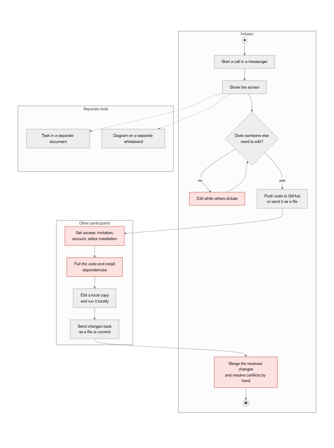
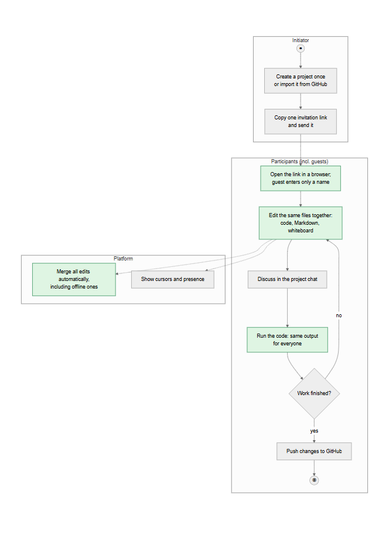
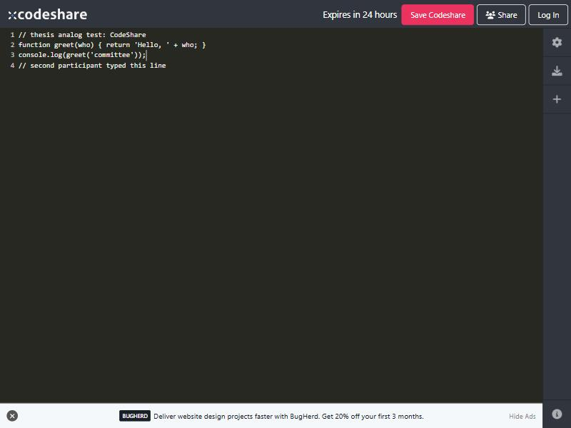
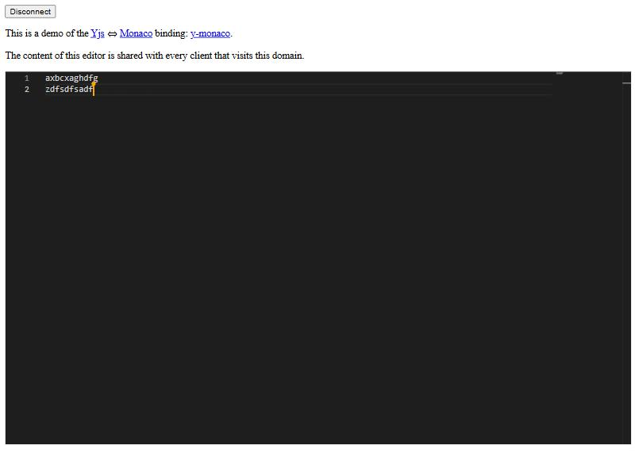
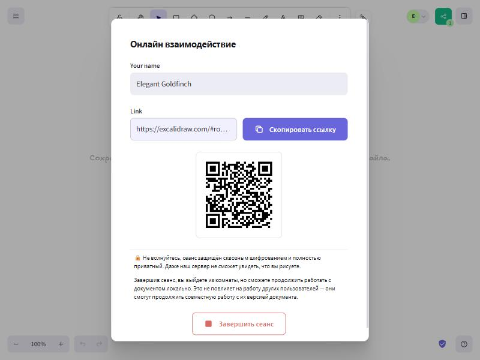
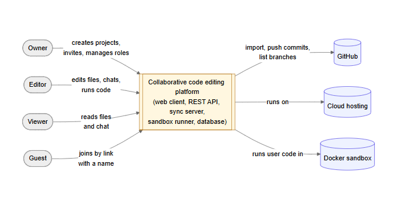
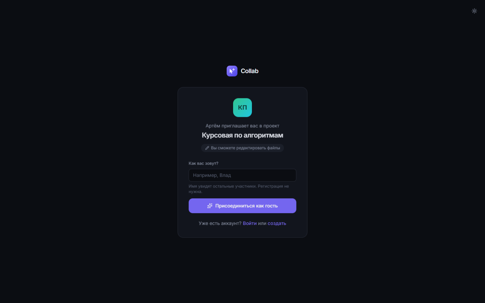
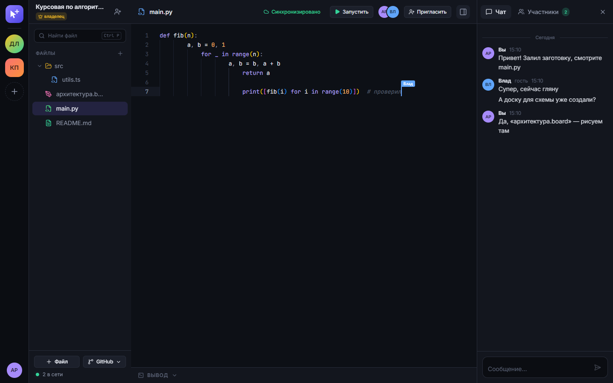
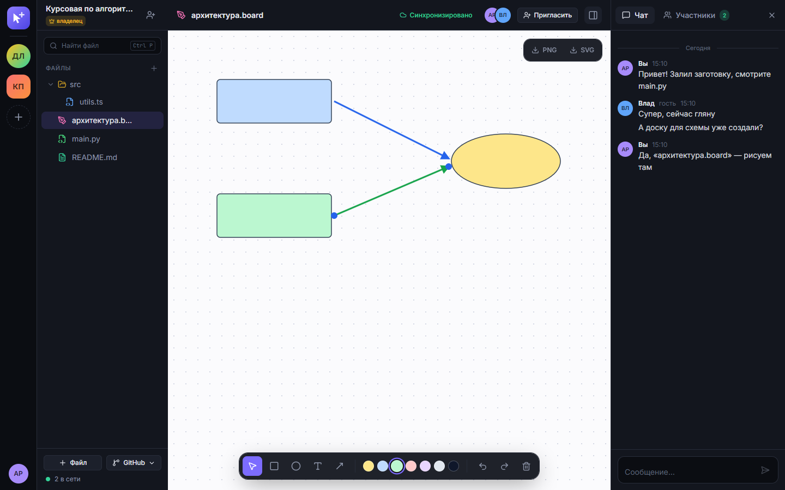
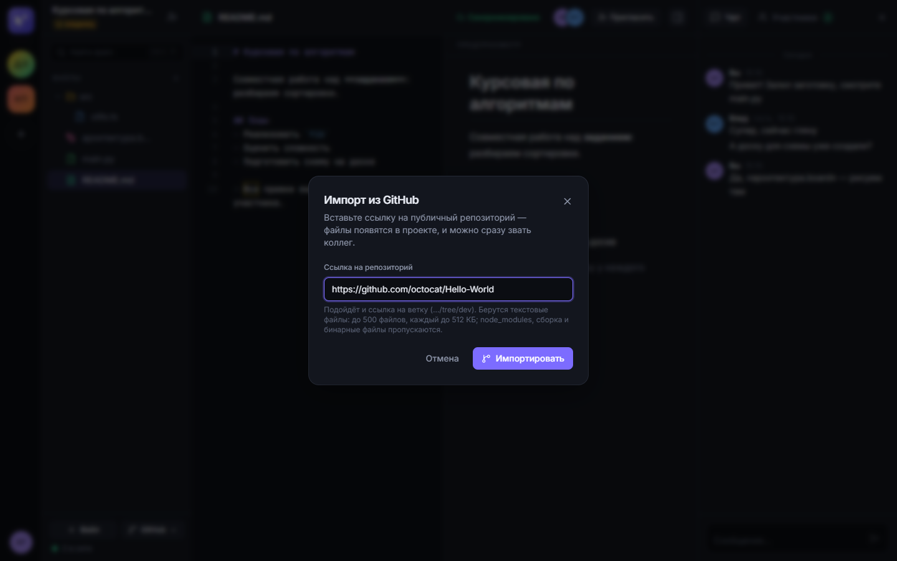

# Introduction

**Relevance and problem.** Software is increasingly written by people who are not in the same room. In the Stack Overflow Developer Survey 2024, 80% of the 54,806 respondents who answered the question work fully remotely (38%) or in a hybrid mode (42%) [1]. Students work the same way: course projects, consultations with a lecturer and pair programming increasingly happen over a video call. Yet the tools for *live* work on the same code are fragmented. A typical session combines a messenger or video call for talking, screen sharing for showing code, GitHub for exchanging it, a separate document for the task and a separate online whiteboard for the diagram. Every participant has to be invited to each tool separately, many of the tools require an account or an installed editor, and edits made in parallel in different copies end up in merge conflicts or are lost.

The problem therefore affects three groups: **students working on team assignments, mentors and lecturers who help them, and small development teams** that need a short joint session rather than a full development process. For them the problem is the time and effort needed to start working on the same code together and the risk of losing work while doing it. It matters now because remote and hybrid work has become the default mode rather than an exception [1], while the real-time collaboration features that exist on the market are either tied to one desktop editor, bound to a paid plan, or limited to one file without the rest of the project (section 1.3). The survey conducted for this work [[TBD: survey — share of respondents who collaborate on code at least weekly, n = …]] confirms that this is a regular, not an occasional, need.

**Goal and objectives.** The goal of the work is to design and build a web platform on which a small team can open a shared project by a link and work on code, documents and diagrams together in real time, without installing software and without losing edits when the connection drops.

To reach the goal, the following objectives are set [[TBD: confirm the wording of the objectives with the supervisor]]:

1. Analyse how live collaborative work on code is organised today, where time and data are lost, and how existing solutions address it.
2. Review the scientific foundations of real-time collaborative editing (Operational Transformation and CRDT) and select an approach that supports offline work.
3. Specify the requirements for the platform: vision, KPIs, stakeholders, scope, epics and user stories, use cases, non-functional, legal and ethical requirements, and risks.
4. Design and implement the platform and verify it against the KPIs and non-functional requirements.
5. Compare OT and CRDT experimentally on the implemented platform (latency, traffic, memory, offline merge).

**Object and subject.** The *object* of the work is the process of real-time collaborative work of a small team on a software project: writing and reviewing code, describing tasks and sketching the design. The *subject* is the automatable side of this process: concurrent editing and synchronisation of shared files, presence and communication of participants, access control, running the code in a safe environment, and exchanging the project with a Git repository.

**Methods.** The requirements were collected and checked with four methods:

- *Document analysis* — scientific literature on collaborative editing, product documentation of existing tools, legal acts and standards (section 1.2).
- *Benchmarking of analogs* — five existing solutions were compared on the same criteria; those available without registration were tried out hands-on with two browser sessions, screenshots are given in section 1.3.
- *Online survey and interviews* — an anonymous questionnaire among students and developers ([[TBD: n = … respondents, collection period]]) and [[TBD: … ]] semi-structured interviews; the questionnaire is given in Appendix C. The survey provides the baseline values of the KPIs (section 2.1).
- *Prototyping and experiment* — the requirements were refined iteratively on a working prototype, and the key technical assumption (that a CRDT can match OT in latency) was tested in a controlled experiment with up to 100 simulated users.

# 1 Analytical part

## 1.1 Current state of the process

**How the task is solved today.** When two or more people need to work on the same piece of code at the same time — a lab assignment, a bug that one student cannot fix alone, a consultation with a lecturer, a code review — the session is usually assembled from several general-purpose tools. Based on the analysis of the tools and the survey [[TBD: survey Q3 — most used tools, % of respondents]], the typical AS-IS process looks as follows (Figure 1.1, full size in Appendix B):

1. The initiator starts a call in a messenger (Discord, Telegram, Zoom, Teams) and shares the screen.
2. The others watch the screen and dictate changes; only the person sharing the screen can edit.
3. When someone else needs to edit, the code is sent as a file or pushed to a GitHub repository; the others pull it, install dependencies and run it locally.
4. Changes made in parallel are sent back as files or commits, and someone merges them manually, resolving conflicts.
5. The task description lives in a separate document (Google Docs), and diagrams in a separate whiteboard (Miro, FigJam, Excalidraw); each tool requires its own invitation and often its own account.

**Who is involved.** The initiator (usually a student or a team lead), other team members, sometimes a lecturer or a mentor, and occasionally an outside participant (for example, a classmate from another group) who does not have accounts in the team's tools.

**Where time and data are lost.**

- *Start-up time.* Before anyone can edit together, every participant has to receive access to several tools, install or sign in, and synchronise the code. In the survey, the median time to start working on the same code is [[TBD: survey Q5 median]].
- *Context switching.* The session is spread over [[TBD: survey Q4 median]] tools; the conversation, the code, the task and the diagram are in different windows and are not linked to each other.
- *Lost and conflicting edits.* Parallel copies of the same file diverge; [[TBD: survey Q6 — share of respondents who lost edits or resolved a merge conflict in the last month]].
- *Passive participants.* With screen sharing only one person types; the others cannot point at or fix the code directly.
- *"Works on my machine".* Code is run separately on each computer with different environments, so the result that the team discusses is not the same for everyone.

**TO-BE.** In the target process (Figure 1.2) the initiator creates a project once and sends one invitation link. Participants open it in a browser — a guest only enters a display name — and immediately see the same files, each other's cursors and who is online. Code, Markdown documents and a whiteboard are files of the same project; the chat is next to them; the code is run on the server in a sandbox and the output is the same for everybody. Edits are merged automatically, including edits made while offline, so there is nothing to merge by hand. When the work is done, the project can be pushed to GitHub.

## 1.2 Review of sources

The sources fall into three groups: algorithms of real-time collaborative editing, the user-perceived quality of interactive systems, and normative documents. Each group directly shaped requirements in Chapter 2.

**Algorithms of collaborative editing.** Ellis and Gibbs introduced Operational Transformation (OT) for group editors: concurrent operations are transformed against each other so that all replicas converge [2]. Sun and Ellis showed that correct transformation functions are hard to design and that practical OT systems rely on a central server that orders operations [3]. This dependency on a central arbiter is acceptable while everyone is online but makes long offline work difficult: the server has to transform a long branch of edits against the operations that happened meanwhile. Shapiro et al. defined Conflict-free Replicated Data Types (CRDT), whose replicas converge by construction without coordination, which gives strong eventual consistency [4]. Nicolaescu et al. presented YATA, the algorithm behind the Yjs library, and showed that a CRDT can support near real-time shared editing with acceptable overhead for documents of practical size [5]. Kleppmann and Beresford extended CRDTs to JSON-like nested structures [6] — the model that fits non-text data such as shapes on a whiteboard, where each property of an object can be resolved independently.

*Conclusion for the requirements:* because participants must be able to keep editing during a connection drop (US-09), a CRDT is preferred over OT for the core synchronisation; the convergence guarantee of CRDTs [4] is the basis of KPI-3 ("no lost edits"), and the object model of [6] is used for the whiteboard (US-12).

**Local-first and recent work.** Kleppmann et al. formulated the principles of *local-first software*: the primary copy of the data is on the user's device, the software works offline, and collaboration is achieved with CRDTs [7]. The principles explain why offline work and automatic merging are treated as user value, not as a technical detail. A recent study by Gentle and Kleppmann (EuroSys 2025) shows that classic text CRDTs pay for their properties with metadata that grows with the editing history, and proposes an algorithm that reduces memory and load time [8]. *Conclusion:* the growth of the document state is recorded as a project risk (R4 in section 2.9) and is measured in the experiment; the Yjs documentation [9] is used for the implementation details.

**Quality of interactive systems and standards.** Nielsen identifies 0.1 s as the limit at which a user perceives a system as reacting instantaneously [10]. *Conclusion:* the latency of edit propagation is bounded by 100 ms at the 95th percentile (NFR-P1, KPI-4). ISO/IEC 25010:2023 defines the product quality model whose characteristics — performance efficiency, security, reliability (availability), and interaction capability (usability) — structure the non-functional requirements in section 2.7 [11]. The General Data Protection Regulation (GDPR) [12] determines how account data, chat messages and survey answers may be processed (section 2.8); WCAG 2.1 [13] defines the accessibility level targeted by the interface; the OWASP Top 10 [14] lists the web application risks that the security requirements address (broken access control, cryptographic failures, injection).

## 1.3 Analysis of analogs

Five solutions were analysed: three commercial products (VS Code Live Share, Replit, CodeShare.io) and two open-source projects (the Yjs collaborative editing framework and the Excalidraw whiteboard). CodeShare.io, Yjs and Excalidraw were tried out hands-on: a session was opened in one browser tab, joined from a second one, and edits were made from both (Figures 1.3–1.5). Live Share and Replit require an account; their properties are taken from the official documentation [15], [16] [[TBD: add your own screenshots of Live Share and Replit sessions, see the shot list in the notes]].

**VS Code Live Share** [15] shares a project opened in the host's VS Code or Visual Studio. Guests can co-edit, co-debug, use shared terminals and servers. Participants normally sign in with a Microsoft or GitHub account; anonymous guests are possible, but only as read-only and with the host's approval. The data is end-to-end encrypted, but the session exists only while the host is online, since the files live on the host's machine.

**Replit** [16] is a browser IDE with built-in collaboration: the owner invites teammates by e-mail or by a private join link. Collaboration seats are part of the paid plans (5 seats on Core, 15 on Pro); the project, the running environment and the AI assistant are in the cloud.

**CodeShare.io** [17] opens a shared editor without registration (Figure 1.3). Typing from a second browser tab appeared in the first one immediately. However, the document is a single file without a project structure, it cannot be run, the participants are anonymous (no names at the cursors), and an unsaved document expires after 24 hours unless the owner creates an account.

**Yjs** [9] is an open-source CRDT framework with bindings to popular editors. Its public Monaco demo (Figure 1.4) shows real-time editing with remote cursors, but it is a building block, not a product: there are no projects, accounts, permissions, chat, or code execution.

**Excalidraw** [18] is an open-source (MIT) whiteboard with "live collaboration" by link, end-to-end encrypted, without registration (Figure 1.5). It covers the diagram part of a session only; the drawing is stored in the browser, and there is no code, no documents and no project membership.

The comparison on seven criteria is given in Table 1.1.

Table 1.1 — Comparison of analogs

| Criterion | Live Share | Replit | CodeShare.io | Yjs (demo) | Excalidraw | Proposed platform |
|---|---|---|---|---|---|---|
| Works in a browser without installation | No (host needs VS Code) | Yes | Yes | Yes | Yes | Yes |
| Join without an account | Read-only, with approval | No | Yes | Yes | Yes | Yes (guest by link) |
| Multi-file project with roles | Yes | Yes | No | No | No | Yes |
| Code, documents and whiteboard in one place | Code only | Code (+ AI) | Code only | Text only | Whiteboard only | Code, Markdown, whiteboard |
| Run code together | Yes (host's machine) | Yes | No | No | — | Yes (server sandbox) |
| Offline work with automatic merge | No | No | No | Yes (library) | No | Yes |
| Session survives the initiator leaving | No | Yes | Yes (24 h) | Yes | Yes | Yes |
| Free collaboration | Yes | Paid plans | Yes (24 h) | Yes | Yes | Yes (self-hosted) |

**What is missing.** None of the analogs combines the three properties that the survey respondents and the use cases need at the same time: (1) *zero-friction entry* — a browser link without an account or installation, with write access; (2) *a persistent multi-file project* in which code, documents, diagrams, chat and execution live together; and (3) *offline-tolerant editing* that merges automatically. Live Share and Replit offer rich projects but require accounts (and, for Replit collaboration, a paid plan); the lightweight tools require nothing but lose the project, the identity of participants and, after 24 hours, the data. Yjs proves that the technical basis exists but is not a ready solution.

## 1.4 Chapter conclusions

The analysis identified the following problems, each linked to a future epic and KPI (Table 1.2).

Table 1.2 — Identified problems, epics and KPIs

| ID | Problem | Epic | KPI |
|---|---|---|---|
| P1 | Starting a joint session takes minutes: invitations, accounts and installations in several tools | E1 Access and projects | KPI-1 Time to collaborate |
| P2 | The session is spread over several unconnected tools | E3 Documents and whiteboard, E4 Communication, E5 Code execution, E6 GitHub | KPI-2 Tools per session |
| P3 | Parallel copies diverge; edits are lost or must be merged by hand | E2 Real-time co-editing, E7 Files and history | KPI-3 Lost edits |
| P4 | Only the screen owner can type; others are passive | E2 Real-time co-editing | KPI-4 Edit latency |
| P5 | Code is run on different machines with different results | E5 Code execution | KPI-2 Tools per session |

The new solution must be able to: open a persistent project by a link in a browser, including for guests without an account; let several people edit code, Markdown documents and a whiteboard at the same time with visible cursors and presence; keep working through connection drops and merge the edits automatically; run code in a shared sandbox with the same output for everyone; and exchange the project with GitHub.

# 2 System requirements

## 2.1 Vision and goals

**Vision.** For students, mentors and small development teams who need to work on the same code together, the platform is a browser workspace that is opened by one link and in which code, documents, diagrams, chat and code execution are shared in real time. Unlike screen sharing and desktop-bound tools, it requires no installation or account from guests and never loses an edit, even after a connection drop.

**Business goals.**

- G1 — Reduce the time needed to start a joint session to about one minute.
- G2 — Replace a set of separate tools with one workspace for a collaborative session.
- G3 — Eliminate lost and manually merged edits in live sessions.
- G4 — Make co-editing feel instantaneous for a typical team and a class-sized group.

The KPIs that measure these goals are given in Table 2.1. Baselines come from the survey (KPI-1 to KPI-3) and from the literature (KPI-4); target values will be checked in a pilot with [[TBD: 5]] pairs of participants and in automated tests.

Table 2.1 — KPIs with baseline and target values

| KPI | Goal | Definition | Baseline | Target | How measured |
|---|---|---|---|---|---|
| KPI-1 Time to collaborate | G1 | Time from sending an invitation to both participants editing the same file | [[TBD: survey Q5 median]] | ≤ 1 min in ≥ 90% of pilot sessions | Timed pilot sessions |
| KPI-2 Tools per session | G2 | Number of separate applications or sites used in one session | [[TBD: survey Q4 median]] | 1 | Post-session questionnaire |
| KPI-3 Lost edits | G3 | Edits lost or merged by hand per session | [[TBD: survey Q6]] | 0; 100% replica convergence in automated tests | Pilot log, convergence tests |
| KPI-4 Edit latency | G4 | 95th percentile of the time between an edit and its appearance at other participants | 100 ms perception threshold [10] | ≤ 100 ms with 50 concurrent editors | Load test with simulated users |

## 2.2 Stakeholders and users

Table 2.2 — Stakeholders

| Stakeholder | Interest | Influence |
|---|---|---|
| Student developer (team member) | Start joint work quickly, not lose edits, run code together | M |
| Team lead / project owner (student) | Control who can edit, keep the project in one place, push to GitHub | M |
| Lecturer / mentor | Join a student's project for a consultation, see and correct the code live | M |
| Guest participant (classmate, interviewer) | Join once by a link without registration | L |
| Author and developer of the platform | Deliver the system within the diploma timeline and resources | H |
| Diploma supervisor and committee | Problem relevance, quality of requirements and of the solution | H |
| Operator of a hosted instance (e.g. university IT) | Security of running user code, cost, personal data compliance | M |
| GitHub (external system) | API usage within rate limits and terms of service | L |

**System users (actors of the scenarios):** *Owner* — creates a project, invites, manages roles; *Editor* — edits files, runs code; *Viewer* — read-only access; *Guest* — joins by a link with only a display name, gets the role encoded in the link; *Registered user* — has an e-mail account and a list of projects. Roles are hierarchical: owner > editor > viewer.

**Personas** [[TBD: adjust to the survey and interview results]].

*Anna, 20, second-year Computer Science student.* Works on a team assignment with three classmates, mostly in the evenings from home. Uses Discord for calls and GitHub for code, but half of the team is not comfortable with Git yet. Main frustration: "Before we start, we spend a quarter of an hour sending files and fixing merge conflicts." Needs: one link for the whole team, everyone typing at once, the task description next to the code.

*Dmitry, 38, lecturer and mentor.* Holds online consultations for students. Wants to open a student's code in a second, point at a line, fix it and run it, without asking the student to install anything or share the screen. Main frustration: "I can only watch the screen and dictate." Needs: guest access by link, visible cursors, running code with the same output for both.

## 2.3 Project scope

**In scope.** Accounts (registration, sign-in, guest access); projects with members, roles and invitation links; a file tree with code files, Markdown documents and whiteboards; real-time co-editing with cursors, presence and offline merge; a project chat; running JavaScript and Python in a sandbox with shared output and an interactive terminal; trash, version history, search; import of a public GitHub repository, pushing changes as a commit and switching branches; a responsive web interface; deployment to a cloud environment; REST API documentation (OpenAPI).

**Out of scope.** Voice and video calls (a separate WebRTC subsystem, unrelated to the research question; teams keep their usual call tool); a step-by-step debugger; a full Git client (merging, pulling others' changes, deleting files in the repository); import of private repositories; native desktop or mobile applications; advanced design tools (pen tool, components, prototyping); payment and subscription management.

Table 2.3 — Assumptions and constraints

| Type | Description |
|---|---|
| Deadline | The BA block is submitted by 30 October 2026, defended on 9–17 November 2026; the final thesis follows the department schedule [[TBD: final submission date]] |
| Resources | One developer; development on a personal computer with Docker; no budget for paid services beyond a minimal cloud deployment [[TBD: confirm the hosting budget]] |
| Access to APIs | The GitHub REST API allows 60 unauthenticated requests per hour per IP; operations above this limit use the user's own token, which is never stored by the server |
| Access to data | No real user data is available or needed; tests use generated accounts; survey answers are anonymous |
| Technology | Users have a modern browser (last two versions of Chrome, Firefox, Edge, Safari); code execution requires Docker on the server |

## 2.4 Solution concept

The platform is a web application (Figure 2.1). A user works in the browser; the client application communicates with a REST API (accounts, projects, files, chat, runs), with a synchronisation server that holds the shared documents (a CRDT, Yjs) and broadcasts edits, cursors and presence over WebSocket, and with a terminal endpoint. A runner service executes code in isolated Docker containers. Data is stored in a relational database (projects, members, files, messages, versions) and a message broker (queues and events). The external systems are GitHub (import, push, branches) and the cloud hosting provider.

Two alternatives were considered before choosing the concept (Table 2.4).

Table 2.4 — Alternatives of the solution

| Criterion | A1: Extension of an existing editor (Live Share-style) | A2: Own web platform with OT (ShareDB) | Chosen: own web platform with CRDT (Yjs) |
|---|---|---|---|
| Entry for guests | Editor installation, account | Browser link | Browser link |
| Offline editing | Not supported | Limited: long branches must be transformed by the server | Native: replicas merge without a central arbiter |
| Session without the initiator | No (files on the host) | Yes | Yes |
| Non-text data (whiteboard) | Not covered | Needs a separate OT type | Shared types (maps, arrays) of the same library |
| Measured edit latency, p95, 50 users | — | ≤ 10.3 ms | ≤ 10.3 ms |
| Risk | Dependency on a closed platform | Complex transformation logic | Growth of the document state (R4) |

*Rationale.* A1 cannot satisfy the zero-friction entry and the persistence of the project (P1). Between A2 and the chosen option the latency is equivalent in the experiment carried out for this work (both ≤ 10.3 ms at the 95th percentile up to 50 users), while the CRDT supports offline editing and the whiteboard natively; therefore the CRDT is chosen, and its weakness — a larger document state — is managed as a risk.

## 2.5 Functional requirements

The functional requirements are organised into seven epics (Table 2.5) and decomposed into 27 user stories prioritised with MoSCoW. The full backlog with acceptance criteria is given in Appendix A; this section lists the epics, the key stories and the traceability from goals to stories.

Table 2.5 — Epics

| Epic | Description | Stories | Goal |
|---|---|---|---|
| E1 Access and projects | Accounts, guest access, projects, invitations, roles | US-01 – US-06, US-27 | G1 |
| E2 Real-time co-editing | Concurrent editing, cursors, presence, offline merge | US-07 – US-10 | G3, G4 |
| E3 Documents and whiteboard | Markdown with preview, shared whiteboard | US-11, US-12 | G2 |
| E4 Communication | Project chat | US-13 | G2 |
| E5 Code execution | Running code in a sandbox, terminal, access code | US-14 – US-16 | G2 |
| E6 GitHub integration | Import, push, branches | US-17 – US-19 | G2 |
| E7 Files and history | File tree, trash, version history, search | US-20 – US-23 | G3 |

Out-of-scope items are recorded as *Won't* stories (US-24 – US-26) so that the decision is visible.

Table 2.6 — Key user stories (excerpt from Appendix A)

| ID | User story | MoSCoW |
|---|---|---|
| US-02 | As a project owner, I want to invite people with a link, so that they can join without manual setup. | Must |
| US-03 | As a guest, I want to join a project by a link entering only my name, so that I can start without registering. | Must |
| US-07 | As an editor, I want to edit the same file at the same time as others and see their changes instantly, so that we work as at one screen. | Must |
| US-08 | As a participant, I want to see the cursors and names of others and who is online, so that we do not edit the same place blindly. | Must |
| US-09 | As a participant with an unstable connection, I want to keep editing offline and have my edits merged automatically, so that no work is lost. | Must |
| US-14 | As an editor, I want to run a JavaScript or Python file in a sandbox and see the output together with others, so that we check the same result. | Should |
| US-12 | As a team member, I want a shared whiteboard with shapes, text and arrows, so that we can sketch the design next to the code. | Should |

**Acceptance criteria of key Must stories (Given/When/Then).**

*US-03 Join as a guest.*
**Given** a valid invitation link with the role "editor" and a visitor who is not signed in,
**When** the visitor opens the link, enters a display name and confirms,
**Then** the visitor becomes a member with the role "editor" and the project opens on a file within 5 seconds.
**Given** an invitation link that was regenerated by the owner,
**When** a visitor opens the old link,
**Then** the system shows "the invitation is invalid or expired" and creates no membership.

*US-07 Co-edit a file.*
**Given** two editors who have the same file open,
**When** one of them types a line,
**Then** the line appears in the other's editor within 100 ms (95th percentile, NFR-P1) and both replicas are identical after the edits stop.

*US-08 Cursors and presence.*
**Given** two participants in the same project,
**When** one of them moves the cursor in a file,
**Then** the other sees a cursor labelled with the first participant's name at that position, and both are listed as online.

*US-09 Offline editing.*
**Given** an editor who loses the connection while a file is open,
**When** the editor keeps typing and the connection is restored,
**Then** the offline edits and the edits made by others meanwhile are merged automatically, without a conflict dialog and without losing any character.

**Mockups of key stories.** Figures 2.2–2.5 show the layouts of four key stories, captured from the working prototype (the interface language of the prototype is Russian).

**Traceability.** Table 2.7 links every business goal to its KPI, epics and the Must and Should stories that realise it.

Table 2.7 — Traceability goal → KPI → epic → story

| Goal | KPI | Epic | Stories |
|---|---|---|---|
| G1 Fast start | KPI-1 | E1 | US-01, US-02, US-03, US-04, US-05 (Must); US-06, US-27 (Should) |
| G2 One workspace | KPI-2 | E3, E4, E5, E6 | US-11, US-12, US-13, US-14, US-17 (Should); US-15, US-16, US-18, US-19 (Could) |
| G3 No lost edits | KPI-3 | E2, E7 | US-09, US-20 (Must); US-21, US-22, US-23 (Should) |
| G4 Instant co-editing | KPI-4 | E2 | US-07, US-08 (Must); US-10 (Should) |

## 2.6 Use case scenarios

**UC-1 Join a project by invitation and co-edit a file**

- *Actor:* Guest (secondary: Owner, other participants).
- *Precondition:* the owner has created a project and shared an invitation link with the role "editor"; the guest has a browser and is not signed in.
- *Postcondition:* the guest is a member of the project and his or her edits are visible to all participants.
- *Main flow:*
  1. The guest opens the invitation link.
  2. The system shows the project name, the inviter and the role that the link gives.
  3. The guest enters a display name and confirms.
  4. The system creates a guest account, adds the guest to the project with the role of the link and opens the project on a start file.
  5. The guest types in the file.
  6. The system delivers the edits to all participants who have the file open and shows the guest's cursor with the name; the guest is listed as online.
- *Alternative flows:*
  - A1 (step 2) — the link is invalid or was regenerated: the system shows an explanation and a link to the guest's own projects; the use case ends.
  - A2 (step 1) — the visitor is already signed in: the system adds the membership and opens the project; steps 2–3 are skipped.
  - A3 (step 4) — the link gives the role "viewer": the project opens read-only, the editor shows "read only", and step 5 is not possible.

The system sequence diagram of UC-1 is given in Appendix B (Figure B.5).

**UC-2 Run code and share the result**

- *Actor:* Editor (secondary: other participants).
- *Precondition:* the editor has a JavaScript or Python file open; code execution is enabled on the server.
- *Postcondition:* all participants see the output, the status and the duration of the run.
- *Main flow:*
  1. The editor presses "Run".
  2. The system takes the current text of the file and the other text files of the project and queues a run.
  3. The system executes the program in an isolated container without network access.
  4. The system streams the output to all participants who have the file open.
  5. The system shows the status ("finished" or "error") and the duration; on an error it highlights the line of the error.
- *Alternative flows:*
  - A1 (step 3) — the program runs longer than 10 s: the system stops the container and shows the status "timeout".
  - A2 (step 1) — the server is a public test host protected by an access code: the system asks for the code once and continues after a correct code.

The activity diagram of UC-2 is given in Appendix B (Figure B.6).

## 2.7 Non-functional requirements

The non-functional requirements follow the quality characteristics of ISO/IEC 25010:2023 [11]; each has a measurable indicator and is linked to KPIs and stories (Table 2.8).

Table 2.8 — Non-functional requirements

| ID | Category | Requirement and measurable indicator | KPI / stories |
|---|---|---|---|
| NFR-P1 | Performance | Edit propagation latency ≤ 100 ms at the 95th percentile with 50 concurrent editors of one document | KPI-4; US-07, US-08 |
| NFR-P2 | Performance | A project with up to 200 files opens (file tree and first file) in ≤ 3 s on a 10 Mbit/s connection | KPI-1; US-03 |
| NFR-P3 | Performance | Output of a trivial program appears in ≤ 3 s after pressing "Run"; any run is stopped after 10 s | US-14 |
| NFR-S1 | Security | Passwords are stored only as Argon2id hashes; access tokens live 15 min, refresh tokens 30 days and are rotated on every use | US-05 |
| NFR-S2 | Security | Every REST and WebSocket request checks project membership and role; a non-member receives 404; revoked members lose open connections within 5 s | US-04 |
| NFR-S3 | Security | User code runs without network, with a read-only file system, ≤ 128 MB memory, ≤ 0.5 CPU, ≤ 64 processes, as an unprivileged user | US-14, US-15 |
| NFR-S4 | Security | On a public instance, sign-in and registration are limited to 20 requests per minute per IP; code execution requires an access code | US-05, US-16 |
| NFR-A1 | Availability | A hosted instance is available ≥ 99% of a calendar month (≤ 7.3 h of downtime), excluding announced maintenance | KPI-1 |
| NFR-A2 | Availability | Edits made during a connection loss are kept locally and merged after reconnection with 0 lost characters | KPI-3; US-09 |
| NFR-U1 | Usability | ≥ 4 of 5 first-time pilot participants join as guests and make their first edit within 60 s without instructions | KPI-1; US-03 |
| NFR-U2 | Usability | The interface is usable at viewport widths from 360 px to 1920 px | US-03, US-07 |
| NFR-U3 | Usability | Text contrast ≥ 4.5:1 and all primary actions available from the keyboard (WCAG 2.1 AA, criteria 1.4.3 and 2.1.1) | Section 2.8 |

## 2.8 Legal and ethical requirements

**Personal data and the legal basis (GDPR [12]).** The platform processes the following personal data: the e-mail address and display name of registered users, the display name of guests (no e-mail), password hashes, refresh tokens, IP addresses in technical logs, and any personal data that users put into files and chat messages. The legal bases are: performance of a contract — providing the service the user signed up for (Art. 6(1)(b)) — for account and project data; legitimate interest in security (Art. 6(1)(f)) for logs and rate limiting. The following requirements follow from the principles of Art. 5 and the data subject rights:

- data minimisation: guests are created without an e-mail; no analytics or tracking cookies are used;
- storage limitation: deleted files are purged after 30 days, refresh tokens expire after 30 days;
- right to erasure (Art. 17): a user can delete the account and the personal data (US-27, Should — not yet implemented in the prototype);
- security of processing (Art. 32): TLS for all connections, hashed passwords, role checks (NFR-S1–S4);
- a privacy notice is shown on registration on any public instance;
- hosting of a production instance in the EU/EEA.

**Consent of survey and interview participants.** The questionnaire is anonymous, collects no names or e-mail addresses and starts with an explicit consent question (Art. 6(1)(a)); interviews are recorded only as anonymised notes after oral consent; the results are published only in aggregated form.

**Licences.** The platform is built on open-source components with permissive licences (Yjs, Hocuspocus, Monaco Editor, React, Konva and xterm.js under MIT; Prisma under Apache 2.0); their licence notices are preserved. User code is executed in official Node.js and Python Docker images. Files imported from GitHub keep the licence of the source repository; the platform does not change it.

**Standards.** The interface targets WCAG 2.1 level AA [13] for contrast and keyboard access (NFR-U3); the security requirements cover the relevant OWASP Top 10 categories [14] — broken access control (NFR-S2), cryptographic failures (NFR-S1) and injection (parameterised database access, sandboxed execution, NFR-S3).

## 2.9 Risks

Table 2.9 — Project risks (P — probability, I — impact: H/M/L)

| ID | Risk | P | I | Mitigation | Dependency |
|---|---|---|---|---|---|
| R1 | Too few survey responses make the KPI baselines unreliable | M | M | Add interviews; publish in developer communities; report n and ranges, not only medians | KPI-1 – KPI-3 |
| R2 | Abuse of code execution or a sandbox escape on a hosted instance | L | H | Container limits (NFR-S3), no network, access code on public hosts, execution can be disabled | E5, NFR-S3 |
| R3 | GitHub API rate limits block import and branch switching | H | M | Use the user's token for API calls, download archives via codeload, clear error messages | E6 |
| R4 | The CRDT document state grows with the editing history and slows down opening | M | M | Measure state size in the experiment; snapshots; follow newer algorithms [8] | KPI-4, NFR-P2 |
| R5 | One developer and a fixed deadline: scope does not fit | M | H | MoSCoW: Could stories are dropped first; Must stories are implemented and tested first | All epics |
| R6 | Cloud costs exceed the free tier | M | M | Single-host deployment, local test hosting for demonstrations | NFR-A1 |
| R7 | Personal data breach (accounts, chat) | L | H | Hashing, TLS, minimisation, role checks, dependency updates | Section 2.8 |

The riskiest part of the project is code execution (R2): it is the only feature that runs untrusted input on the server. It is isolated by container limits, can be switched off, and on publicly reachable test hosts requires an access code known only to the operator.

## 2.10 Chapter conclusions

The requirements specification fixes: the vision and four business goals with KPIs and baselines; the stakeholders, actors and personas; the scope with assumptions and constraints; the solution concept (a web platform with a CRDT) chosen over two alternatives; 27 user stories in seven epics with MoSCoW priorities and acceptance criteria; two use case scenarios with a system sequence diagram and an activity diagram; twelve non-functional requirements with measurable indicators; the legal and ethical requirements; and seven risks with mitigations.

The result will be verified against the KPIs of section 2.1: KPI-1 and NFR-U1 in timed pilot sessions with first-time participants; KPI-2 with a post-session questionnaire in the same pilot; KPI-3 with the pilot log and automated convergence tests of all replicas; KPI-4 and NFR-P1 with a load test of up to 100 simulated users. The functional requirements are verified by automated end-to-end tests that implement the acceptance criteria of the Must stories.
